# Dante Connection Protocol (Newton Dock Protocol)

This document is a restructured Markdown edition of the original
[Dante Connection Protocol](https://40hz.org/Pages/newton/hacking/newton-docking-protocol/)
Engineering Requirements Specification.

---

## Table of Contents

- [1. Overview & Packet Framing](#1-overview--packet-framing)
- [2. Newton 1.0 ROM Base Protocol](#2-newton-10-rom-base-protocol)
  - [2.1 Command Summary](#21-command-summary)
  - [2.2 Session Flows](#22-session-flows)
  - [2.3 Detailed Command Specifications](#23-detailed-command-specifications)
- [3. Newton 2.0 ROM Extensions](#3-newton-20-rom-extensions)
  - [3.1 Starting a Session & Authentication](#31-starting-a-session--authentication)
  - [3.2 Remote Query](#32-remote-query)
  - [3.3 Keyboard Passthrough](#33-keyboard-passthrough)
  - [3.4 Sync & Selective Sync](#34-sync--selective-sync)
  - [3.5 File Browsing](#35-file-browsing)
  - [3.6 File Importing](#36-file-importing)
  - [3.7 Package Loading (Newton-Initiated)](#37-package-loading-newton-initiated)
  - [3.8 Restore Originated on Newton](#38-restore-originated-on-newton)
  - [3.9 Desktop-Initiated Functions While Connected](#39-desktop-initiated-functions-while-connected)
  - [3.10 Miscellaneous Additions](#310-miscellaneous-additions)
- [4. Compatibility & Testing Requirements](#4-compatibility--testing-requirements)
- [5. Appendix: NTK (Newton Toolkit) Commands](#5-appendix-ntk-newton-toolkit-commands)

---

## 1. Overview & Packet Framing

The Dante Connection Protocol is used to communicate between a desktop host (macOS or Windows) and an Apple Newton device by exchanging Newton event commands.

Every Dock command shares a 16-byte header followed by an optional payload:

```text
+--------+--------+--------+--------+-----------------------+
| 'newt' | 'dock' | 'aaaa' | length | data (optional)       |
| 4 B    | 4 B    | 4 B    | 4 B    | length bytes + pad    |
+--------+--------+--------+--------+-----------------------+
```

- `'newt'` / `'dock'` — Fixed 8-byte protocol signature.
- `'aaaa'` — Specific 4-character command tag (FourCC).
- `length` — 4-byte unsigned/signed big-endian length (in bytes) of the `data` field that follows `length`.
  - Unless noted otherwise (e.g., `kDBackupIDs` uses `length = -1`), `length` does not include trailing alignment padding.
- `data` — Command payload, padded with `0x00` bytes to a 4-byte boundary.
- **Strings:** All strings are null-terminated C strings unless specified otherwise (such as UTF-16/Unicode strings or NewtonScript object refs).
- **Notation:** In detailed packet layouts below, size annotations like `4 longs` refer to the 4 header fields (`'newt'`, `'dock'`, command tag, `length`); the `'newt'` and `'dock'` fields are omitted from each listing for brevity.

---

## 2. Newton 1.0 ROM Base Protocol

The 1.0 protocol defines the core session handshake, store/soup inspection and manipulation, entry synchronization, package installation/backup, and patch retrieval.

### 2.1 Command Summary

#### Newton → Desktop

| Command | FourCC | Payload Summary |
|---|---|---|
| `kDRequestToDock` | `'rtdk'` | Protocol version (`long`) |
| `kDNewtonName` | `'name'` | Version info + Newton Unicode name |
| `kDCurrentTime` | `'time'` | Current time on the Newton |
| `kDStoreNames` | `'stor'` | Array of store info frames |
| `kDSoupNames` | `'soup'` | Array of soup names + array of signatures |
| `kDSoupIDs` | `'sids'` | Count + array of entry IDs in current soup |
| `kDChangedIDs` | `'cids'` | Count + array of changed entry IDs |
| `kDResult` | `'dres'` | Error code (`long`, `0` = OK) |
| `kDAddedID` | `'adid'` | ID of the newly added entry (`long`) |
| `kDEntry` | `'entr'` | Flattened entry data |
| `kDPackageIDList` | `'pids'` | Count + binary list of package structs |
| `kDPackage` | `'apkg'` | Package ID + binary package data |
| `kDIndexDescription` | `'indx'` | Index description array |
| `kDInheritance` | `'dinh'` | Array of `(class, superclass)` pairs |
| `kDPatches` | `'patc'` | Patch data (listed as no data in summary) |

#### Desktop → Newton

| Command | FourCC | Payload Summary |
|---|---|---|
| `kDInitiateDocking` | `'dock'` | Session type (`long`) |
| `kDLastSyncTime` | `'stme'` | Time of last sync (`long`) |
| `kDGetStoreNames` | `'gsto'` | None |
| `kDGetSoupNames` | `'gets'` | None |
| `kDSetCurrentStore` | `'ssto'` | Store frame |
| `kDSetCurrentSoup` | `'ssou'` | Soup name (C string, `< 25` chars) |
| `kDGetSoupIDs` | `'gids'` | None |
| `kDGetChangedIDs` | `'gcid'` | None |
| `kDDeleteEntries` | `'dele'` | Count + array of entry IDs |
| `kDAddEntry` | `'adde'` | Flattened entry ref |
| `kDReturnEntry` | `'rete'` | Entry ID (`long`) |
| `kDReturnChangedEntry` | `'rcen'` | Entry ID (`long`) |
| `kDEmptySoup` | `'esou'` | Soup name (C string) |
| `kDDeleteSoup` | `'dsou'` | Soup name (C string) |
| `kDLoadPackage` | `'lpkg'` | Binary package data (4-byte padded) |
| `kDGetPackageIDs` | `'gpid'` | None |
| `kDBackupPackages` | `'bpkg'` | None |
| `kDDisconnect` | `'disc'` | None |
| `kDDeleteAllPackages` | `'dpkg'` | None |
| `kDGetIndexDescription` | `'gind'` | None |
| `kDCreateSoup` | `'csop'` | Soup name + index description |
| `kDGetInheritance` | `'ginh'` | None |
| `kDSetTimeout` | `'stim'` | Timeout in seconds (`long`) |
| `kDGetPatches` | `'gpat'` | None |
| `kDDeletePkgDir` | `'dpkd'` | None |
| `kDGetSoupInfo` | `'gsin'` | None |

#### Bidirectional (Desktop ↔ Newton)

| Command | FourCC | Payload Summary |
|---|---|---|
| `kDChangedEntry` | `'cent'` | Flattened changed entry data |
| `kDTest` | `'test'` | Variable-length test data |
| `kDHello` | `'helo'` | None (keepalive) |
| `kDSoupInfo` | `'sinf'` | Soup info frame |

> **Note:** In the original ERS, `kDLastSyncTime` is inconsistently spelled `kDLastSyncTIme`, and `kDGetChangedIDs` appears as `kdGetChangedIDs` in the summary list.

---

### 2.2 Session Flows

#### Session Startup (1.0)

Every 1.0 session must begin with this sequence regardless of intent (if the desktop does not wish to set a timeout, it may send `kDResult` instead of `kDSetTimeout`):

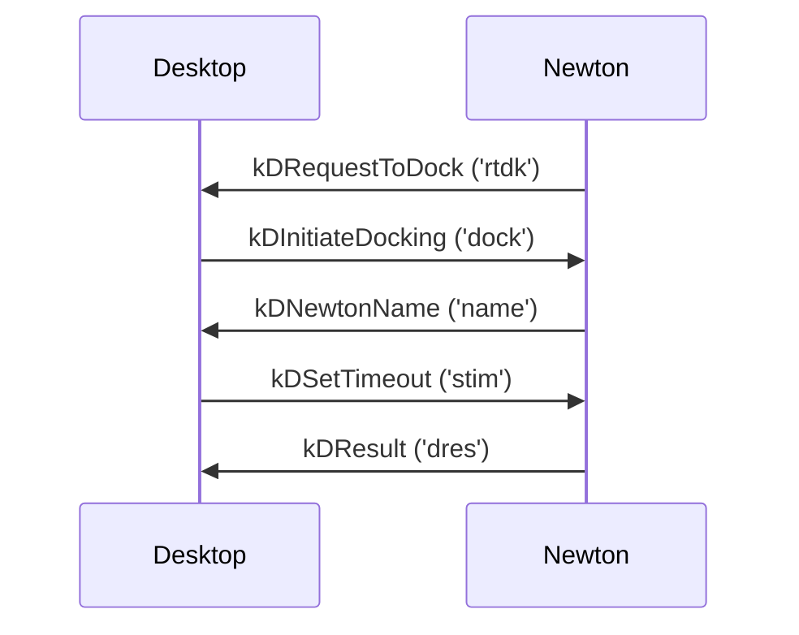

#### Synchronize Session (1.0)

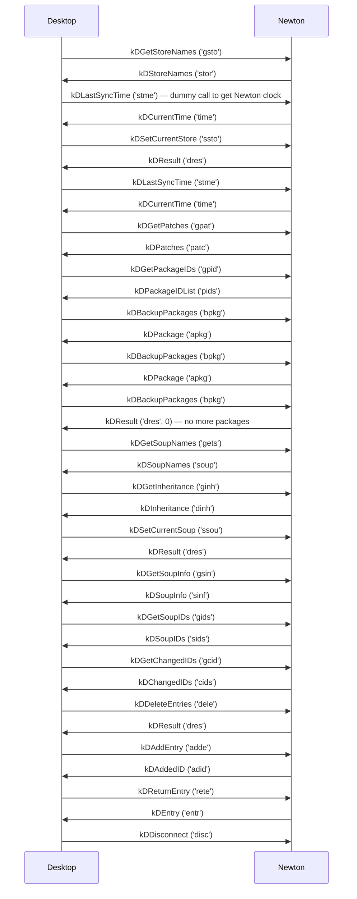

#### Restore & Load Package Sessions (1.0)

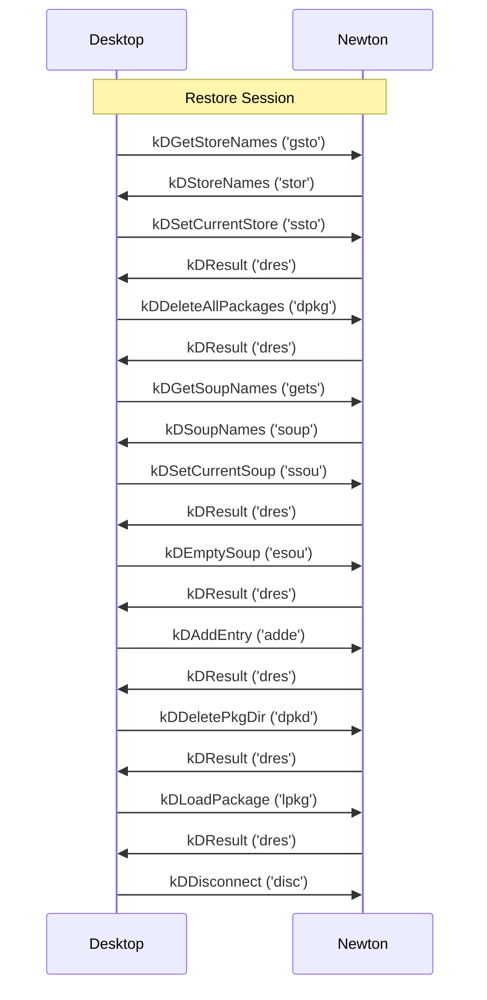

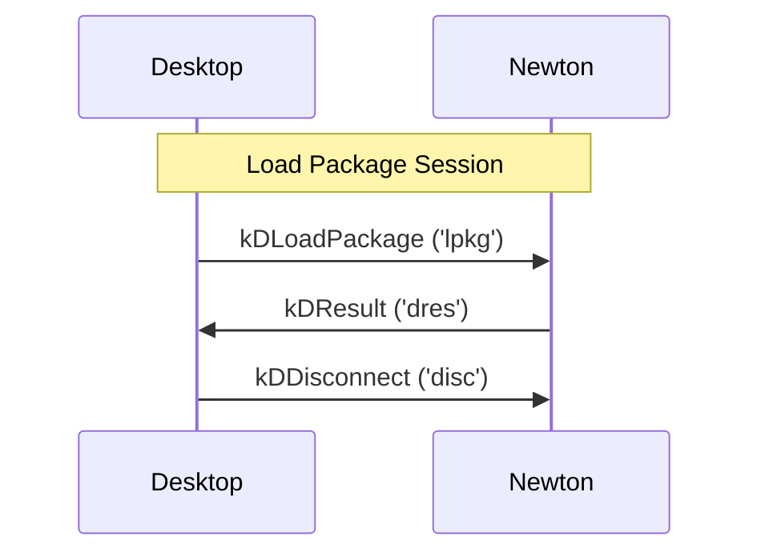

---

### 2.3 Detailed Command Specifications

#### Newton → Desktop

##### `kDRequestToDock` — 5 longs (header + version)

```text
'rtdk'
length
protocol version
```

Sent by the Newton when initiating a connection over network, serial, etc. The Newton expects a `kDInitiateDocking` command in response. `protocol version` identifies the messaging protocol version being used.

##### `kDNewtonName` — 4 longs + version info + name

```text
'name'
length
version info
name
```

Sent in response to a valid `kDInitiateDocking` command. The Newton's name is used to locate the matching synchronize file; `version info` includes machine type (e.g., `J1`), ROM version, etc. (See [`kDNewtonName` in Section 3.1](#kdnewtonname--4-longs--version-info--name-1) for the full field list.)

##### `kDStoreNames` — 4 longs + array of store frames

```text
'stor'
length
array of frames
```

Sent in response to `kDGetStoreNames`. Returns an array of frames describing every store on the Newton:

```newtonscript
{
    Name: "",
    signature: 1234,
    totalsize: 1234,
    usedsize: 1234,
    kind: "",
    info: { /* store info frame */ },
    readOnly: true,
    defaultStore: true,     // only present on the default store
    storePassword: password // only present if a store password is set
}
```

##### `kDSoupNames` — 4 longs + two arrays

```text
'soup'
length
[names]      // array of strings
[signatures] // array of corresponding soup signatures
```

Sent in response to `kDGetSoupNames`. Returns the names and signatures of all soups in the current store.

##### `kDIndexDescription` — 4 longs + index description

```text
'indx'
length
indexes
```

Specifies the indexes that should be created for the current soup.

> **ERS Erratum:** The original ERS detail block lists `'didx'`, whereas the command table and `TDCLDockCommand.h` use `'indx'`.

##### `kDSoupIDs` — 5 longs + IDs array

```text
'sids'
length
count   // number of elements in ids array
[ids]   // array of IDs for the soup
```

Sent in response to `kDGetSoupIDs`. Returns all entry IDs in the current soup.

##### `kDChangedIDs` — 5 longs + IDs array

```text
'cids'
length
count   // number of elements in ids array
[ids]   // array of changed IDs for the soup
```

Sent in response to `kDGetChangedIDs`. Returns all IDs with modification time greater than the last sync time. If the last sync time is `0` (first sync), no changed entries are returned.

##### `kDResult` — 5 longs

```text
'dres'
length     // = 4
error code // long (0 = success)
```

Sent in response to desktop commands that do not return data, letting the desktop know whether the operation succeeded or failed.

##### `kDAddedID` — 5 longs

```text
'adid'
length // = 4
ID     // long
```

Sent in response to `kDAddEntry`. Returns the ID assigned to the entry in the current soup.

##### `kDEntry` — 4 longs + entry data

```text
'entr'
length // length of flattened entry data
entry  // binary data
```

Sent in response to `kDReturnEntry` for the specified entry ID in the current soup.

##### `kDPackageIDList` — 5 longs + binary package records

```text
'pids'
length // length of package id list
count  // number of packages
package info
```

Sent in response to `kDGetPackageIDs` (for the current store only). Unlike frame-based responses, `package info` is sent as raw packed binary records rather than a NewtonScript array:

```c
ULong     packageSize;
ULong     packageId;
ULong     packageVersion;
ULong     format;
ULong     deviceKind;
ULong     deviceNumber;
ULong     deviceId;
ULong     modifyDate;
ULong     isCopyProtected;
ULong     length;
Character name[]; // `length` bytes of Unicode string
```

##### `kDPackage` — 5 longs + package data

```text
'apkg'
length     // length of package
package ID
entry      // package binary data
```

Sent repeatedly in response to `kDBackupPackages`.

---

#### Desktop → Newton

##### `kDInitiateDocking` — 5 longs

```text
'dock'
length       // = 4
session type
```

Sent in response to `kDRequestToDock`. Valid `session type` values:

| Value | Name |
|---:|---|
| `0` | `none` |
| `1` | `settingUp` |
| `2` | `synchronize` |
| `3` | `restore` |
| `4` | `loadPackage` |
| `5` | `testComm` |
| `6` | `loadPatch` |
| `7` | `updatingStores` |

##### `kDSetTimeout` — 5 longs

```text
'stim'
length
timeout in seconds
```

Sets the connection inactivity timeout (how long the Newton waits for incoming data before disconnecting), typically `30` seconds.

> **ERS Erratum:** The original ERS placed this detail block under *Newton → Desktop* even though its command table and flow examples list it as *Desktop → Newton*.

##### `kDGetSoupNames` — 4 longs

```text
'gets'
length // = 0
```

Requests the list of soups on the current store. Expects `kDSoupNames` in response.

##### `kDSetCurrentStore` — 4 longs + store frame

```text
'ssto'
length
store frame
```

Sets the current store on the Newton using a store frame to uniquely identify it:

```newtonscript
{
    name: "foo",
    kind: "bar",
    signature: 1234,
    info: { /* info frame */ } // optional
}
```

##### `kDSetCurrentSoup` — 4 longs + soup name

```text
'ssou'
length
soup name // C string (< 25 characters)
```

Sets the current soup. Most soup-level commands operate on this soup. If the soup does not exist, a `kDSoupNotFound` error is returned via `kDResult`, leaving the connection open so the desktop can create the soup if needed. Soup names must be shorter than 25 characters.

##### `kDGetIndexDescription` — 4 longs

```text
'gind'
length // = 0
```

Requests the index definitions for the current soup.

> **ERS Erratum:** The original ERS detail block lists `'gidx'`, whereas the command table and `TDCLDockCommand.h` use `'gind'`.

##### `kDGetSoupIDs` — 4 longs

```text
'gids'
length // = 0
```

Requests all entry IDs for the current soup. Expects `kDSoupIDs` in response.

##### `kDGetChangedIDs` — 4 longs

```text
'gcid'
length // = 0
```

Requests the IDs of entries changed since the last sync time for the current soup. Expects `kDChangedIDs` in response.

> **ERS Erratum:** The original ERS detail block lists `'gids'`, whereas the command table and `TDCLDockCommand.h` use `'gcid'`.

##### `kDDeleteEntries` — 5 longs + ID array

```text
'dele'
length
count of ids
[ids] // IDs to delete
```

Deletes one or more entries from the current soup.

##### `kDAddEntry` — 4 longs + entry ref

```text
'adde'
length // length of data
data   // entry ref
```

Adds an entry to the current soup. Expects `kDAddedID` (or `kDResult`) in response.

##### `kDReturnEntry` — 5 longs

```text
'rete'
length // = 4
id     // ID of the entry to return
```

Requests an entry from the current soup. Expects `kDEntry` in response.

##### `kDReturnChangedEntry` — 5 longs

```text
'rcen'
length // = 4
id     // ID of the entry to return
```

Requests a changed entry from the current soup. Expects `kDChangedEntry` in response.

##### `kDEmptySoup` — 4 longs + soup name

```text
'esou'
length
soup name // C string
```

Used during restore to remove all entries from a soup before restoring its data.

> **ERS Erratum:** The original ERS detail block lists `'dsou'`, whereas the command table and `TDCLDockCommand.h` use `'esou'`.

##### `kDDeleteSoup` — 4 longs + soup name

```text
'dsou'
length
soup name // C string
```

Used during restore to delete a soup that exists on the Newton but not on the desktop.

##### `kDLoadPackage` — 4 longs + package data

```text
'lpkg'
length
package data // binary data, padded with 0x00 to a multiple of 4 bytes
```

Loads a package into the Newton's RAM.

##### `kDGetPackageIDs` — 4 longs

```text
'gpid'
length // = 0
```

Requests the list of package IDs on the Newton (used to detect packages deleted on the Newton). Expects `kDPackageIDList`.

##### `kDBackupPackages` — 4 longs

```text
'bpkg'
length // = 0
```

Requests backup of packages installed on the Newton. Expects `kDPackage`, or `kDResult` with error `0` when no more packages remain.

##### `kDDisconnect` — 4 longs

```text
'disc'
length // = 0
```

Sent when the docking operation is complete.

---

#### Bidirectional (Desktop ↔ Newton)

##### `kDChangedEntry` — 4 longs + entry data

```text
'cent'
length // length of flattened entry data
entry  // binary data
```

Sent by the Newton in response to `kDReturnChangedEntry`; can also be sent by the desktop.

##### `kDHello` — 4 longs

```text
'helo'
length // = 0
```

Keepalive heartbeat sent during long operations so neither side drops the connection.

##### `kDSoupInfo` — 4 longs + soup info frame

```text
'sinf'
length
soup info frame
```

Transfers a soup info frame; when received, sets the info frame for the current soup.

> **ERS Erratum:** The original ERS detail block writes `length // 0` despite specifying a `soup info frame` payload (`4 longs + soup info frame`).

---

## 3. Newton 2.0 ROM Extensions

Newton 2.0 extends the base protocol with version negotiation, authentication, remote queries, keyboard passthrough, selective sync, Newton-driven file browsing/importing/restoring, and desktop-initiated idle requests.

### 3.1 Starting a Session & Authentication

To preserve package downloading from older clients (NPI 1.0, NTK 1.0, Connection 2.0), a 2.0 Newton always announces protocol version `9` (the 1.0 ROM version) in `kDRequestToDock`. A 3.0-aware desktop upgrades the session by sending `kDDesktopInfo`, and the Newton responds with `kDNewtonInfo` containing an equal or lower version.

> **cDCL Note:** `TDCLDockCommand.h` defines `kProtocolVersion = 10` and notes that sending version `9` in `kDDesktopInfo` causes the Newton to reply with error `-28011` (`kPDILIncompatableProtocol`).

#### Command Summary

| Direction | Command | FourCC | Payload Summary |
|---|---|---|---|
| Newton → Desktop | `kDNewtonName` | `'name'` | Version info (15 longs) + Unicode name |
| Newton → Desktop | `kDNewtonInfo` | `'ninf'` | Negotiated protocol version + encrypted key (2 longs) |
| Newton → Desktop | `kDPassword` | `'pass'` | Encrypted key |
| Desktop → Newton | `kDInitiateDocking` | `'dock'` | Session type (`long`) |
| Desktop → Newton | `kDDesktopInfo` | `'dinf'` | Protocol version, OS type, key, session type, flags, apps |
| Desktop → Newton | `kDWhichIcons` | `'wicn'` | Bitmask of icons shown on Newton UI |

#### Session Startup Flows

**2.0 Newton ↔ 3.0 Connection (Normal Startup):**

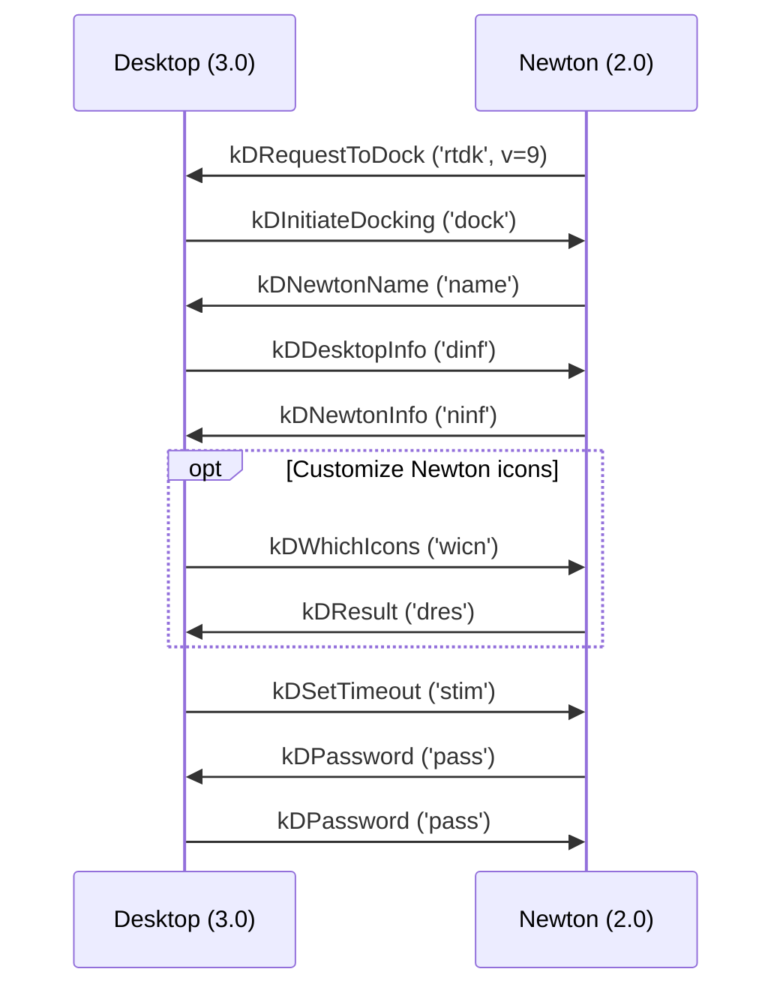

> **Note:** As in 1.0, the desktop can substitute `kDResult` for `kDSetTimeout` if it does not want to set a timeout. If no password has been specified, the key is returned unencrypted.

**Password Verification Cases:**

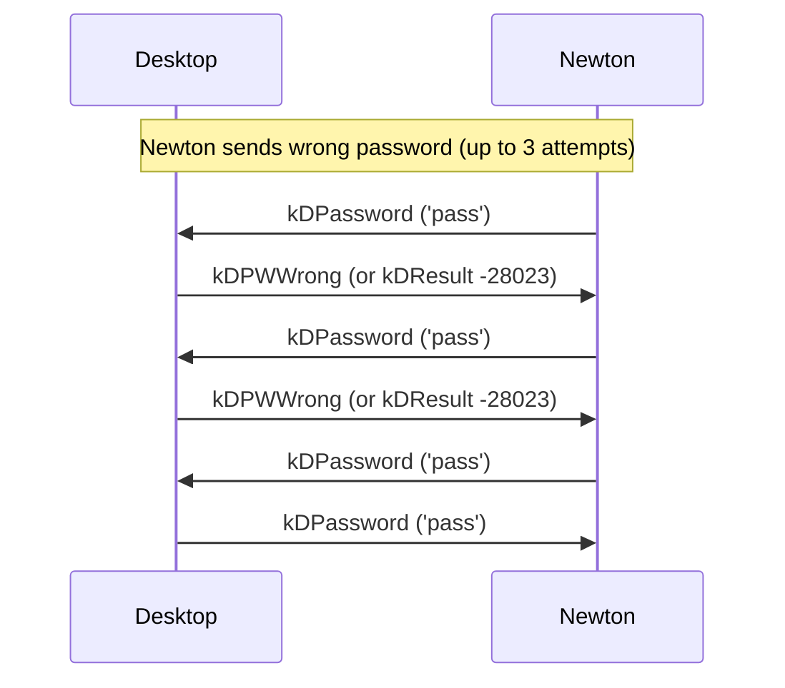

If the desktop wants to reject further attempts, it sends `kDResult` with a `kDBadPassword` error (`-28022`) instead of `kDPWWrong`. If the password sent *by the desktop* is wrong, the Newton signals an error immediately (`kDResult` after desktop's `kDPassword`).

> **cDCL Note:** `kDPWWrong` does not appear in the command tables or `TDCLDockCommand.h`; cDCL uses `kDResult` with `kRetryPassword_Err = -28023` (`kPDILRetryPW`) and `kBadPassword_Err = -28022`.

**2.0 Newton ↔ Legacy Clients (NPI 1.0, NTK 1.0, Connection 2.0):**

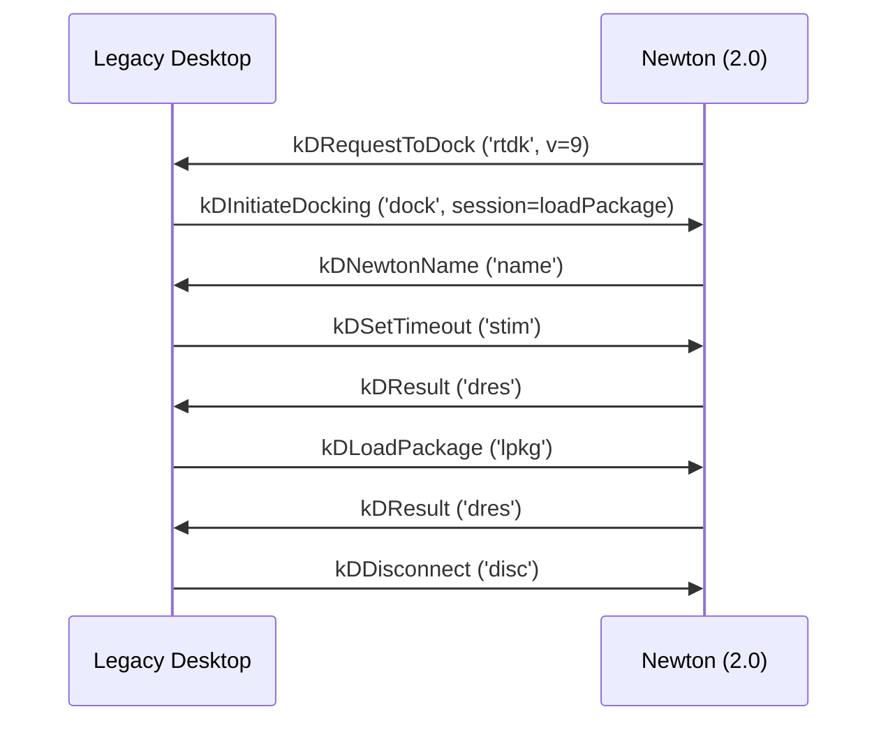

#### Detailed Command Specifications

##### `kDPassword` — 4 longs + key

```text
'pass'
length
encrypted Key
```

Returns the key received in `kDDesktopInfo` / `kDNewtonInfo` (originally described as `initiateDocking` in the ERS) encrypted using the password.

##### `kDNewtonInfo` — 5 longs + key

```text
'ninf'
length
protocol version
encrypted key // 2 longs
```

Negotiates the actual protocol version (see `kDDesktopInfo`) and exchanges the password verification key.

##### `kDNewtonName` — 4 longs + version info + name

```text
'name'
length
version info
name
```

Sent in response to `kDInitiateDocking`. `version info` consists of 15 `long` fields (a byte-length field followed by 14 metadata fields):

1. `length of version info in bytes`
2. `newtonUniqueID` — unique identifier for the Newton
3. `manufacturer id`
4. `machine type`
5. `rom version`
6. `rom stage`
7. `ram size`
8. `screen height`
9. `screen width`
10. `system update version`
11. `Newton object system version`
12. `signature of internal store`
13. `vertical screen resolution`
14. `horizontal screen resolution`
15. `screen depth`

Followed by the Newton's name as a null-terminated Unicode string, padded with `0` bytes to a 4-byte boundary (padding bytes are not included in the command header `length`).

##### `kDDesktopInfo` — 4 longs + fields

```text
'dinf'
length
protocol version
desktopType        // 0 = Mac, 1 = Windows
encrypted key      // 2 longs
session type
allowSelectiveSync // 0 = no, 1 = yes
desktopApps        // ref
```

- `protocol version`: The protocol version requested by the desktop. The Newton replies via `kDNewtonInfo` with a version `<=` this value.
- `desktopType`: `0` for macOS, `1` for Windows.
- `encrypted key`: 2-long challenge key used for password verification.
- `session type`: Real session type overriding `kDInitiateDocking` (either the same value or `settingUp` to indicate the user has not yet chosen an operation).
- `allowSelectiveSync`: Boolean (`0` = no, `1` = yes). Should be `0` until the user has completed a full sync.
- `desktopApps`: Array of frames describing connected desktop applications:
  ```newtonscript
  [{ name: "Newton Backup Utility", id: 1, version: 1 }]
  ```
  The built-in Connection app expects a single item with `id: 1` (NBU) or `id: 2` (NCU) and rejects other IDs (unless connecting via a DIL app).

##### `kDWhichIcons` — 5 longs

```text
'wicn'
length
iconMask
```

Customizes which icons appear on the Newton Connection slip by OR'ing/summing the bit flags:

| Icon | Value |
|---|---:|
| `kBackupIcon` | `1` |
| `kRestoreIcon` | `2` |
| `kInstallIcon` | `4` |
| `kImportIcon` | `8` |
| `kSyncIcon` | `16` |
| `kKeyboardIcon` | `32` |

---

### 3.2 Remote Query

These commands mirror NewtonScript query/cursor functions (see the *Newton Programmer's Guide*). `kDQuery` returns a cursor ID (`kDLongData`), which is passed to subsequent cursor commands. Entries are returned via `kDEntry`.

#### Command Summary

| Direction | Command | FourCC | Payload Summary |
|---|---|---|---|
| Newton → Desktop | `kDLongData` | `'ldta'` | `long` result (e.g., cursor ID, count, end state) |
| Newton → Desktop | `kDRefResult` | `'ref '` | NewtonScript ref result (e.g., from `kDCursorMap`) |
| Desktop → Newton | `kDQuery` | `'qury'` | Parameter frame (`queryspec`, optional `soupname`) |
| Desktop → Newton | `kDCursorGotoKey` | `'goto'` | `cursor id` + key |
| Desktop → Newton | `kDCursorMap` | `'cmap'` | `cursor id` + function |
| Desktop → Newton | `kDCursorEntry` | `'crsr'` | `cursor id` |
| Desktop → Newton | `kDCursorMove` | `'move'` | `cursor id` + `count` |
| Desktop → Newton | `kDCursorNext` | `'next'` | `cursor id` |
| Desktop → Newton | `kDCursorPrev` | `'prev'` | `cursor id` |
| Desktop → Newton | `kDCursorReset` | `'rset'` | `cursor id` |
| Desktop → Newton | `kDCursorResetToEnd` | `'rend'` | `cursor id` |
| Desktop → Newton | `kDCursorCountEntries` | `'cnt '` | `cursor id` |
| Desktop → Newton | `kDCursorWhichEnd` | `'whch'` | `cursor id` |
| Desktop → Newton | `kDCursorFree` | `'cfre'` | `cursor id` |

#### Detailed Command Specifications

##### `kDLongData` — 5 longs

```text
'ldta'
length
data
```

Returns a `long` value whose interpretation depends on the initiating command.

##### `kDQuery` — 4 longs + parameter frame

```text
'qury'
length
parameter frame
```

Executes a query on the current store. The parameter frame must contain a `queryspec` slot (full query spec including valid test functions, etc.) and may contain a `soupname` slot (if empty string or `NILREF`, queries the current soup). Returns `kDLongData` containing the cursor ID.

##### `kDCursorGotoKey` — 5 longs + key size

```text
'goto'
length
cursor id
key
```

Moves to and returns the entry at `key`, or `nil` if not found.

##### `kDCursorEntry` — 5 longs

```text
'crsr'
length
cursor id
```

Returns the entry at the current cursor position.

##### `kDCursorMap` — 5 longs + function size

```text
'cmap'
length
cursor id
function
```

Applies `function` to each entry in the cursor and returns an array of results via `kDRefResult` (see `MapCursor` in NPG).

##### `kDCursorMove` — 6 longs

```text
'move'
length
cursor id
count
```

Moves the cursor forward `count` entries and returns that entry (or `nil` if moved past the last entry).

##### `kDCursorNext` — 5 longs

```text
'next'
length
cursor id
```

Advances to the next entry and returns it (or `nil` past the end).

##### `kDCursorPrev` — 5 longs

```text
'prev'
length
cursor id
```

Moves to the previous entry and returns it (or `nil` before the first entry).

##### `kDCursorReset` — 5 longs

```text
'rset'
length
cursor id
```

Resets the cursor to its initial state. Returns `kDResult` (`0`).

##### `kDCursorResetToEnd` — 5 longs

```text
'rend'
length
cursor id
```

Resets the cursor to the rightmost entry in the valid subset. Returns `kDResult` (`0`).

##### `kDCursorCountEntries` — 5 longs

```text
'cnt '
length
cursor id
```

Returns the count of matching entries via `kDLongData`.

##### `kDCursorWhichEnd` — 5 longs

```text
'whch'
length
cursor id
```

Returns `kDLongData`: `0` = unknown, `1` = start, `2` = end.

##### `kDCursorFree` — 5 longs

```text
'cfre'
length
cursor id
```

Disposes the cursor and returns `kDResult` (`0` or error).

---

### 3.3 Keyboard Passthrough

#### Command Summary

| Direction | Command | FourCC | Payload Summary |
|---|---|---|---|
| Desktop → Newton | `kDKeyboardChar` | `'kbdc'` | 2-byte Unicode char + 2-byte key state |
| Desktop → Newton | `kDKeyboardString` | `'kbds'` | Array/string of 2-byte Unicode chars |
| Bidirectional | `kDStartKeyboardPassthrough` | `'kybd'` | None |

#### Passthrough Flows

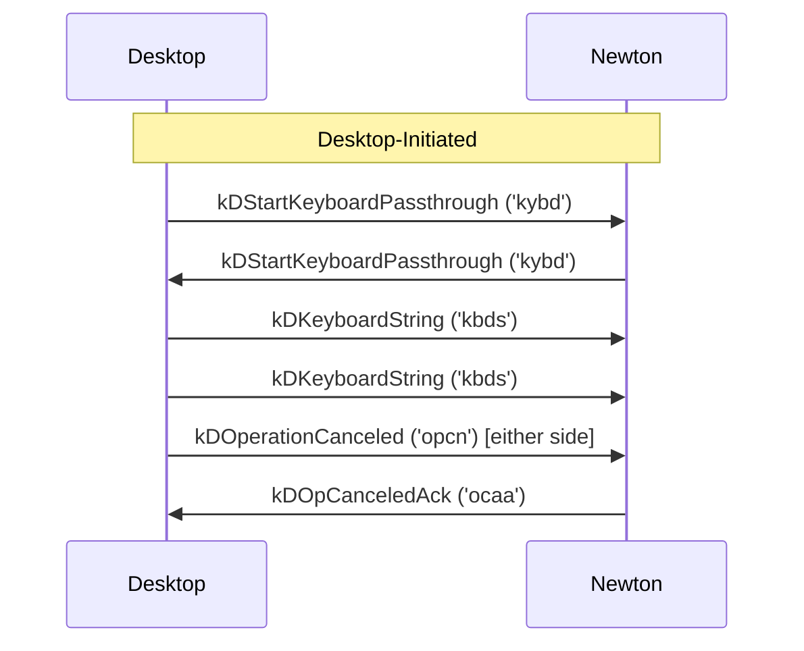

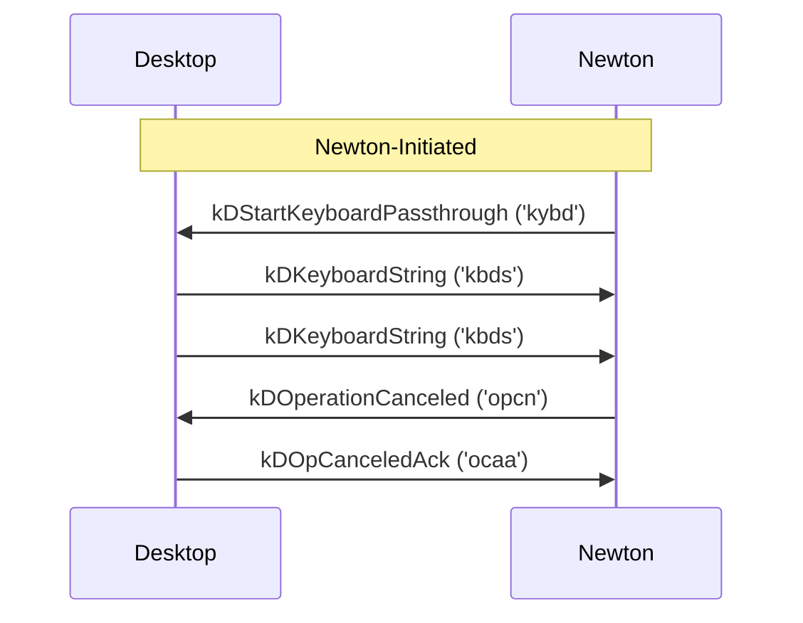

#### Detailed Command Specifications

##### `kDKeyboardChar` — 5 longs

```text
'kbdc'
length
char   // 2-byte Unicode character
state  // 2-byte modifier state
```

Sends a single character to the Newton. `state` bit flags:
- Bit `1`: Command key down.

##### `kDKeyboardString` — 4 longs + string length

```text
'kbds'
length
"string"
```

Sends a string of 2-byte Unicode characters. If there is an odd number of characters, pad with `0x00` to a 4-byte boundary as usual.

##### `kDStartKeyboardPassthrough` — 4 longs

```text
'kybd'
length
```

Enters keyboard passthrough mode. May be followed by `kDKeyboardChar`, `kDKeyboardString`, `kDHello`, and `kDOperationDone` (listed as `kDOperationComplete` in the ERS text) / `kDOperationCanceled`.

---

### 3.4 Sync & Selective Sync

#### Command Summary

| Direction | Command | FourCC | Payload Summary |
|---|---|---|---|
| Newton → Desktop | `kDRequestToSync` | `'ssyn'` | None (`length = 0`) |
| Newton → Desktop | `kDSyncOptions` | `'sopt'` | Selective sync options frame |
| Desktop → Newton | `kDGetSyncOptions` | `'gsyn'` | None (`length = 0`) |
| Desktop → Newton | `kDSyncResults` | `'sres'` | Conflict/restore results array |
| Desktop → Newton | `kDSetStoreGetNames` | `'ssgn'` | Store frame → returns `kDSoupNames` |
| Desktop → Newton | `kDSetSoupGetInfo` | `'ssgi'` | Soup name (C string) → returns `kDSoupInfo` or `kDResult` |
| Desktop → Newton | `kDGetChangedIndex` | `'cidx'` | None → index description if modified |
| Desktop → Newton | `kDGetChangedInfo` | `'cinf'` | None → soup info if modified |

#### Sync Flow (2.0)

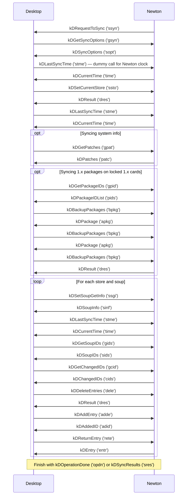

> **Note:** `kDBackupPackages` only syncs 1.x-style packages on locked 1.x cards; to complete package syncing on 2.0, the `Packages` soup must also be synced.

#### Detailed Command Specifications

##### `kDRequestToSync` — 4 longs

```text
'ssyn'
length // = 0
```

Sent when the Newton wants to initiate a sync operation.

##### `kDSyncOptions` — 4 longs + frame length

```text
'sopt'
length
frame of info
```

> **ERS Erratum:** The original ERS detail block lists `'ssyn'`, whereas the command table and `TDCLDockCommand.h` use `'sopt'`.

Sent when the user selects selective sync on the Newton. Specifies what should be synchronized:

```newtonscript
{
    packages: TRUEREF,
    syncAll: TRUEREF,
    stores: [
        {
            Name: "",
            signature: 1234,
            totalsize: 1234,
            usedsize: 1234,
            kind: "",
            soups: [/* soup names */],
            signatures: [/* soup signatures */],
            info: { /* store info frame */ }
        }
    ]
}
```

- If `syncAll` (sync all information) is selected, the `soups` slot is omitted (all soups are assumed), though the user can still select specific `stores`.
- If packages are selected, `packages` is true and the `Packages` soup is included in the store frame(s).

##### `kDGetSyncOptions` — 4 longs

```text
'gsyn'
length // = 0
```

Requests selective sync or selective restore options from the Newton.

##### `kDSyncResults` — 4 longs + array

```text
'sres'
length
results array
```

Optionally sent at the end of synchronization to display results on the Newton:

```newtonscript
[
    ["store name", restored, "soup name", count, "soup name", count],
    ["store name", restored, ...]
]
```

- `restored`: `true` if the desktop detected that the Newton was restored since the last sync.
- `count`: Number of conflicting entries in that soup (soups are only listed if they had conflicts; on conflict, the Newton version is kept and the desktop version is archived).

##### `kDSetStoreGetNames` — 4 longs + store frame

```text
'ssgn'
length
store frame
```

Combines `kDSetCurrentStore` and `kDGetSoupNames`. Accepts the same identifying store frame (`{ name, kind, signature, info }`) and responds with `kDSoupNames`.

##### `kDSetSoupGetInfo` — 4 longs + C string length

```text
'ssgi'
length
soup name // C string
```

Combines `kDSetCurrentSoup` and `kDGetChangedInfo`. Responds with `kDSoupInfo` or `kDResult`.

##### `kDGetChangedIndex` — 4 longs

```text
'cidx'
length
```

Like `kDGetIndexDescription`, but returns the index description only if modified since the time set by `kDLastSyncTime`; otherwise returns `kDResult` (`0`).

##### `kDGetChangedInfo` — 4 longs

```text
'cinf'
length
```

Like `kDGetSoupInfo`, but returns the soup info frame only if modified since the time set by `kDLastSyncTime`; otherwise returns `kDResult` (`0`).

---

### 3.5 File Browsing

Unlike synchronization (driven by the desktop), file browsing, importing, package loading, and Newton-initiated restore are driven by the Newton.

#### Command Summary

| Direction | Command | FourCC | Platform | Payload Summary |
|---|---|---|---|---|
| Newton → Desktop | `kDRequestToBrowse` | `'rtbr'` | All | File types (`'import`, `'packages`, `'syncFiles`, or string array) |
| Newton → Desktop | `kDGetDevices` | `'gdev'` | Windows | None (`length = 0`) |
| Newton → Desktop | `kDGetDefaultPath` | `'dpth'` | All | None (`length = 0`) |
| Newton → Desktop | `kDGetFilesAndFolders` | `'gfil'` | All | None (`length = 0`) |
| Newton → Desktop | `kDSetPath` | `'spth'` | All | Array of path components |
| Newton → Desktop | `kDGetFileInfo` | `'gfin'` | All | Filename string or Desktop item frame |
| Newton → Desktop | `kDInternalStore` | `'isto'` | All | Internal store frame |
| Newton → Desktop | `kDResolveAlias` | `'rali'` | Mac | None (`length = 0` in spec; alias name in flow) |
| Newton → Desktop | `kDGetFilters` | `'gflt'` | Windows | None (`length = 0`) |
| Newton → Desktop | `kDSetFilter` | `'sflt'` | Windows | 0-based filter index (`long`) |
| Newton → Desktop | `kDSetDrive` | `'sdrv'` | Windows | Drive string (e.g., `"C:"`) |
| Desktop → Newton | `kDDevices` | `'devs'` | Windows | Array of device frames |
| Desktop → Newton | `kDFilters` | `'filt'` | Windows | Array of filter strings (or `nil`) |
| Desktop → Newton | `kDPath` | `'path'` | All | Array of path element frames |
| Desktop → Newton | `kDFilesAndFolders` | `'file'` | All | Array of file/folder/disk frames |
| Desktop → Newton | `kDFileInfo` | `'finf'` | All | File info frame |
| Desktop → Newton | `kDGetInternalStore` | `'gist'` | All | None (`length = 0`) |
| Desktop → Newton | `kDAliasResolved` | `'alir'` | Mac | `0` (cannot resolve) or non-zero/`1` (resolved) |

#### Browsing Flows

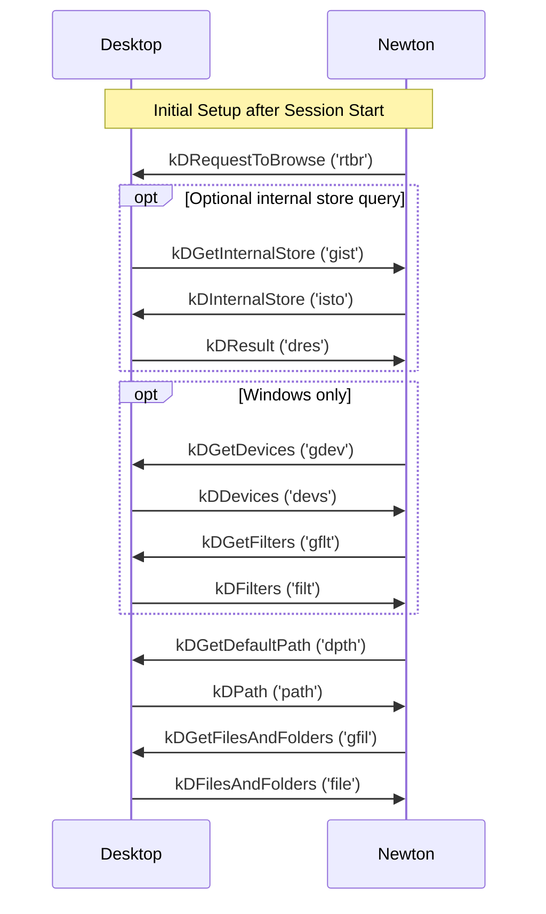

> **Note:** The transaction must still begin with `kDRequestToDock` so that 1.0 and 2.0 Connection clients display the expected message.

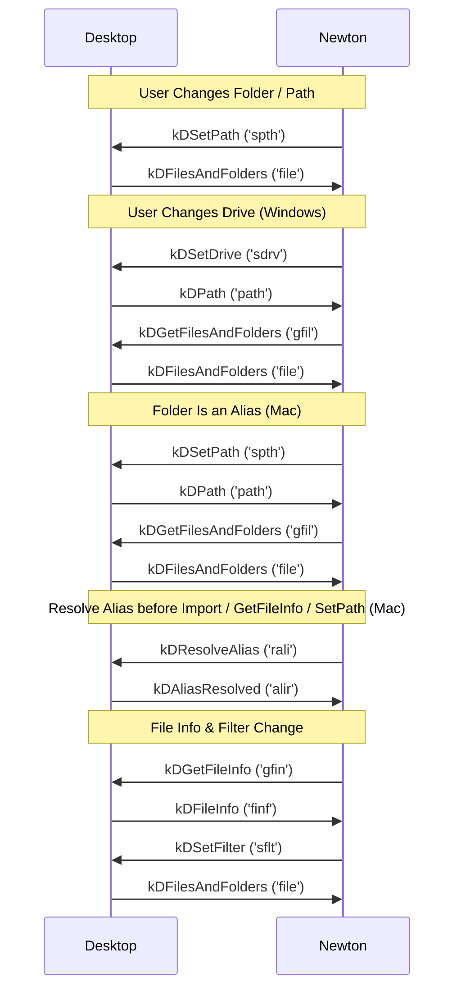

#### Detailed Command Specifications

##### `kDRequestToBrowse` — 4 longs + file types

```text
'rtbr'
length
file types
```

`file types` can be `'import`, `'packages`, `'syncFiles`, or an array of filter strings.

##### `kDGetDevices` (Windows) — 4 longs

```text
'gdev'
length // = 0
```

Requests an array of device frames (`kDDevices`).

##### `kDGetDefaultPath` — 4 longs

```text
'dpth'
length // = 0
```

Requests the starting path (`kDPath`) for the Mac folder popup or Windows directory list.

##### `kDGetFilesAndFolders` — 4 longs

```text
'gfil'
length // = 0
```

Requests the files and folders (`kDFilesAndFolders`) in the current directory.

##### `kDSetPath` — 4 longs + array

```text
'spth'
length
array of strings/frames
```

Changes the current path on the desktop and returns `kDFilesAndFolders` (sent as strings/mixed array for performance):

- **Mac:** Always starts with `"Desktop"`; the second element is a frame with `whichVol` (`0` for a volume, negative `volRefNum` for a Desktop folder item):
  - Volume subfolder (`My hard disk:Business:`): `["Desktop", { Name: "My hard disk", whichVol: 0 }, "Business"]`
  - Desktop folder (`My hard disk:Desktop Folder:Business:`): `["Desktop", { Name: "Business", whichVol: -1 }]`
- **Windows:** `["c:\\", "business"]` for `c:\business`.

##### `kDSetDrive` (Windows) — 4 longs + string

```text
'sdrv'
length
drive string // e.g. "C:"
```

Changes the current drive and sets the path to the current directory on that drive, returning `kDPath`.

##### `kDGetFileInfo` — 4 longs + string/frame

```text
'gfin'
length
filename string (or Desktop frame)
```

Requests `kDFileInfo` for the specified file. If the item is at the Desktop level (Mac), sends `{ Name: "Business", whichVol: -1 }` instead of a string.

##### `kDInternalStore` — 4 longs + store frame

```text
'isto'
length
store frame
```

Returns info about the Newton's internal store (same as `kDStoreNames` without the nested `info` frame):

```newtonscript
{
    Name: "Internal",
    signature: 1234,
    totalsize: 1234,
    usedsize: 1234,
    kind: "Internal"
}
```

##### `kDResolveAlias` — 4 longs

```text
'rali'
length // = 0
```

Asks the desktop (Mac) to resolve an alias, expecting `kDAliasResolved`. *(Note: the flow example notes the alias name is passed in `kDResolveAlias`.)*

##### `kDGetFilters` (Windows) — 4 longs

```text
'gflt'
length // = 0
```

Requests the list of file filters (`kDFilters`).

##### `kDSetFilter` (Windows) — 5 longs

```text
'sflt'
length
index // 0-based index into filters array
```

Sets the active filter; expects `kDFilesAndFolders` in return.

##### `kDDevices` (Windows) — 4 longs + array

```text
'devs'
length
array
```

Returns device frames for the Windows device popup:

```newtonscript
{
    name: "c:mydisk",
    disktype: 1 // optional if icon unavailable: 0=floppy, 1=hardDrive, 2=cdRom, 3=netDrive
}
```

##### `kDFilters` (Windows) — 4 longs + array

```text
'filt'
length
filter array // array of strings, or nil to hide the filter popup
```

##### `kDPath` — 4 longs + folder array

```text
'path'
length
folder array
```

Returns path components for the Mac folder popup / Windows directory list (also returned when following a Mac folder alias). Each element is a frame:

```newtonscript
{
    name: "my hard disk",
    type: disk,         // 0=desktop, 1=file, 2=folder, 3=disk
    disktype: harddrive,// present when type==disk: 0=floppy, 1=hardDrive, 2=cdRom, 3=netDrive
    whichVol: 0         // present on 2nd item (after Desktop): 0=disk, volRefNum=Desktop item
}
```

Examples:
- Mac volume path: `[{ name: "desktop", type: desktop }, { name: "my hard disk", type: disk, disktype: harddrive, whichvol: 0 }, { name: "business", type: folder }]`
- Mac Desktop folder path: `[{ name: "desktop", type: desktop }, { name: "business", type: folder, whichvol: -1 }, { name: "my folder", type: folder }]`
- Windows path: `[{ name: "c:\\", type: 'folder }, { name: "business", type: 'folder }]`

##### `kDFilesAndFolders` — 4 longs + array

```text
'file'
length
file/folder array
```

Returns ordered entries for the Newton file browser dialog:

```newtonscript
{
    name: "whatever",
    type: kFolder,  // 0=desktop, 1=file, 2=folder, 3=disk
    disktype: 0,    // optional, if type == disk (0=floppy, 1=hardDrive, 2=cdRom, 3=netDrive)
    whichVol: 0,    // optional, if current location is Desktop (0=disk, <0=volRefNum)
    alias: nil      // optional; existence of slot indicates an alias
}
```

##### `kDFileInfo` — 4 longs + frame

```text
'finf'
length
frame of info
```

```newtonscript
{
    kind: "Microsoft Word document",
    size: 20480,                  // actual byte size (not disk blocks)
    created: 3921837,             // Newton date format
    modified: 3434923,            // Newton date format
    icon: <binary object of icon>,// optional
    path: "hd:files:another folder:" // user-understandable path
}
```

##### `kDGetInternalStore` — 4 longs

```text
'gist'
length // = 0
```

Requests `kDInternalStore` from the Newton.

##### `kDAliasResolved` — 5 longs

```text
'alir'
length // = 4
0 or 1 // 0 = cannot resolve, non-zero = resolved
```

---

### 3.6 File Importing

File importing builds on the file browsing interface.

#### Command Summary

| Direction | Command | FourCC | Payload Summary |
|---|---|---|---|
| Newton → Desktop | `kDImportFile` | `'impt'` | Filename string or Desktop frame |
| Newton → Desktop | `kDSetTranslator` | `'tran'` | Translator index (`long`) |
| Desktop → Newton | `kDTranslatorList` | `'trnl'` | Array of translator name strings |
| Desktop → Newton | `kDImporting` | `'dimp'` | None (`length = 0`) |
| Desktop → Newton | `kDSoupsChanged` | `'schg'` | Array of `{ soupName, count }` frames |
| Desktop → Newton | `kDSetStoreToDefault` | `'sdef'` | None (`length = 0`) |

#### Import Flows

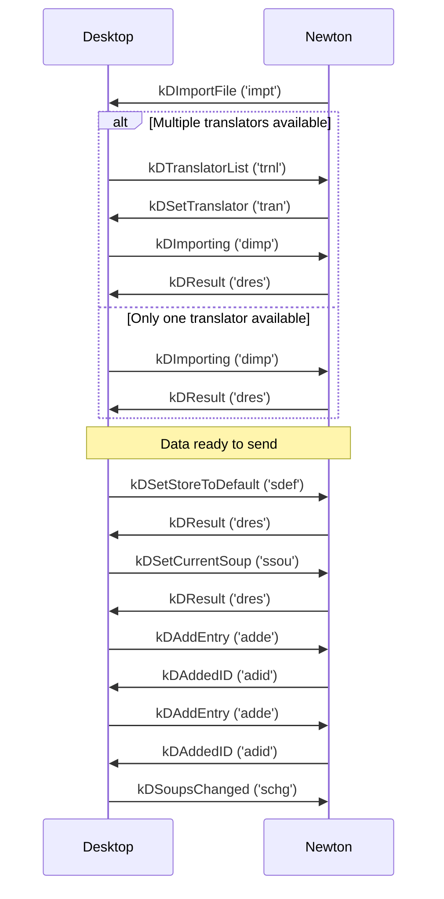

#### Detailed Command Specifications

##### `kDImportFile` — 4 longs + filename

```text
'impt'
length
filename string (or Desktop frame)
```

Requests import of the file identified by the last path command and filename (or `{ Name: "Business", whichVol: -1 }` if at the Mac Desktop level). Desktop replies with `kDTranslatorList` or `kDImporting`.

##### `kDSetTranslator` — 5 longs

```text
'tran'
length // = 4
translator index
```

Selects an index into the `kDTranslatorList` array; desktop acknowledges with `kDImporting`.

##### `kDTranslatorList` — 4 longs + array

```text
'trnl'
length
array of strings
```

Ordered list of applicable DataViz translators and tab templates.

##### `kDImporting` — 4 longs

```text
'dimp'
length // = 0
```

Notifies the Newton that import is starting so it can display progress UI.

##### `kDSoupsChanged` — 4 longs + array

```text
'schg'
length
array
```

Reports imported entry counts per soup:

```newtonscript
[{ soupName: "Notes", count: 7 }, { soupName: "Names", count: 3 }]
```

##### `kDSetStoreToDefault` — 4 longs

```text
'sdef'
length // = 0
```

Alternative to `kDSetCurrentStore` that selects the user's configured default store (internal or card).

---

### 3.7 Package Loading (Newton-Initiated)

Uses the file browsing interface to select a package on the desktop.

| Direction | Command | FourCC | Payload Summary |
|---|---|---|---|
| Newton → Desktop | `kDLoadPackageFile` | `'lpfl'` | Filename string or Desktop frame |

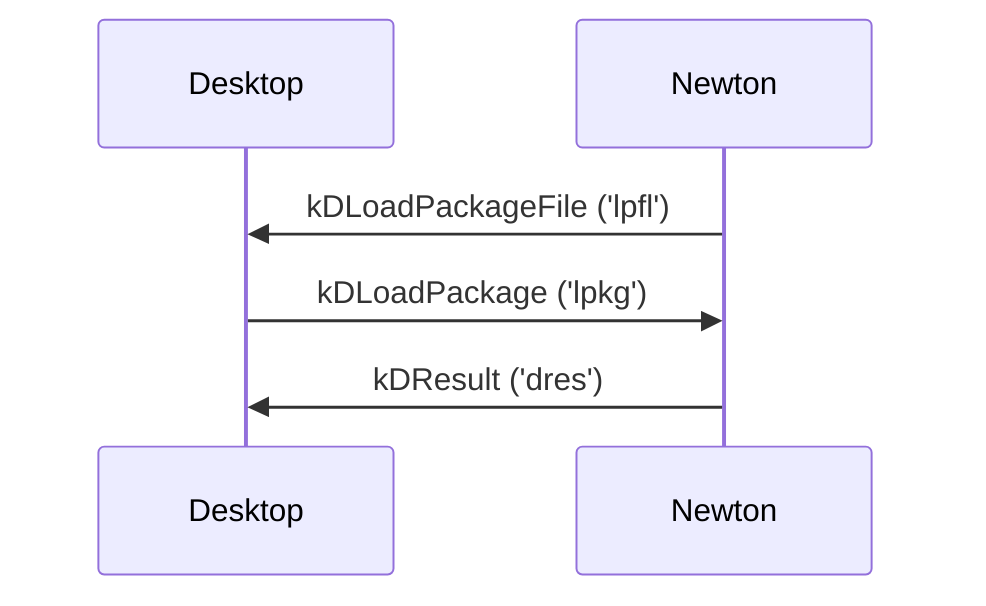

##### `kDLoadPackageFile` — 4 longs + filename

```text
'lpfl'
length
filename string (or Desktop frame)
```

Asks the desktop to load the selected package (`{ Name: "Business", whichVol: -1 }` at the Mac Desktop level, otherwise a string).

> **ERS Erratum:** The original ERS detail block accidentally wrote `'impt'` instead of `'lpfl'`.

---

### 3.8 Restore Originated on Newton

Uses the file browsing interface to select a backup file to restore.

#### Command Summary

| Direction | Command | FourCC | Payload Summary |
|---|---|---|---|
| Newton → Desktop | `kDRestoreFile` | `'rsfl'` | Filename string or Desktop frame |
| Newton → Desktop | `kDGetRestoreOptions` | `'grop'` | None |
| Newton → Desktop | `kDRestoreAll` | `'rall'` | Merge flag (`0` = no merge, `1` = merge) |
| Bidirectional | `kDRestoreOptions` | `'ropt'` | `restoreWhich` frame |
| Bidirectional | `kDRestorePackage` | `'rpkg'` | Array of all entries for a package |

#### Restore Flows

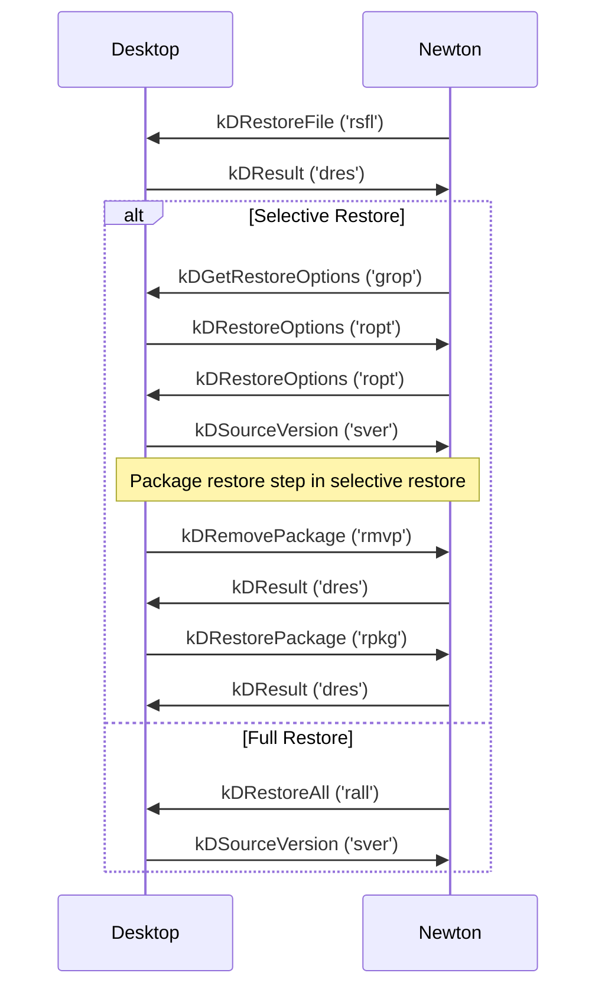

#### Detailed Command Specifications

##### `kDRestoreFile` — 4 longs + filename

```text
'rsfl'
length
filename (or Desktop frame)
```

Asks the desktop to restore the selected backup file (`{ Name: "Business", whichVol: -1 }` at the Mac Desktop level, otherwise a string).

> **ERS Erratum:** The original ERS detail block accidentally wrote `'impt'` instead of `'rsfl'`.

##### `kDGetRestoreOptions` — 4 longs

```text
'grop'
length
```

Sent when the user chooses selective restore; expects `kDRestoreOptions`.

##### `kDRestoreAll` — 5 longs

```text
'rall'
length
merge // 0 = do not merge, 1 = merge
```

Sent when the user chooses a full restore.

##### `kDRestoreOptions` — 4 longs + ref

```text
'ropt'
length
restoreWhich
```

Sent by the desktop to list restorable apps/packages, and returned by the Newton with the user's selective restore choices:

```newtonscript
{
    storeType: kRestoreToNewton, // 0 = kRestoreToNewton, 1 = kRestoreToCard
    packages: ["pkg1", ...],
    applications: ["app1", ...]
}
```

##### `kDRestorePackage` — 4 longs + ref

```text
'rpkg'
length
package array
```

Restores a package by sending all its associated entries in one array (at least two entries: package info + each package part). Returns `kDResult`.

---

### 3.9 Desktop-Initiated Functions While Connected

When connected in the idle `settingUp` state (neither side has started an operation), the desktop can request an operation on behalf of the desktop user:

| Direction | Command | FourCC | Payload Summary |
|---|---|---|---|
| Desktop → Newton | `kDRequestToSync` | `'ssyn'` | None (`length = 0`) |
| Desktop → Newton | `kDRequestToRestore` | `'rrst'` | None (`length = 0`) |
| Desktop → Newton | `kDRequestToInstall` | `'rins'` | None (`length = 0`) |

- `kDRequestToSync` (`'ssyn'`) — Request to start a sync operation.
- `kDRequestToRestore` (`'rrst'`) — Request to start a restore operation.
- `kDRequestToInstall` (`'rins'`) — Request to start a load package operation.

---

### 3.10 Miscellaneous Additions

#### Command Summary

##### Newton → Desktop

| Command | FourCC | Payload Summary |
|---|---|---|
| `kDDefaultStore` | `'dfst'` | Default store info frame |
| `kDAppNames` | `'appn'` | Array of app frames (with optional soup lists) |
| `kDImportParameterSlipResult` | `'islr'` | Import slip result frame (or `nil` if cancelled) |
| `kDPackageInfo` | `'pinf'` | Array of package info frames |
| `kDSetBaseID` | `'base'` | 32-bit base offset (`long`) for subsequent `kDBackupIDs` |
| `kDBackupIDs` | `'bids'` | `length = -1`, RLE-compressed 16-bit ID words |
| `kDBackupSoupDone` | `'bsdn'` | None (terminates `kDBackupSoup` / `kDSendSoup`) |
| `kDSoupNotDirty` | `'ndir'` | None (soup unchanged since last backup) |
| `kDSynchronize` | `'sync'` | None (user tapped Synchronize on Newton) |
| `kDCallResult` | `'cres'` | Return value ref from `kDCallGlobalFunction` / `kDCallRootMethod` |

##### Desktop → Newton

| Command | FourCC | Payload Summary |
|---|---|---|
| `kDRemovePackage` | `'rmvp'` | Package name ref |
| `kDResultString` | `'ress'` | `errorNumber` + `errorStringRef` |
| `kDSourceVersion` | `'sver'` | `vers` (`1` = 1.x, `2` = 2.x), `manufacturer`, `machineType` |
| `kDAddEntryWithUniqueID` | `'auni'` | Entry ref with explicit ID (restore only) |
| `kDGetPackageInfo` | `'gpin'` | Package title ref |
| `kDGetDefaultStore` | `'gdfs'` | None (`length = 0`) |
| `kDCreateDefaultSoup` | `'cdsp'` | Soup name (C string) |
| `kDGetAppNames` | `'gapp'` | Option `long` (`0`–`3`) |
| `kDRegProtocolExtension` | `'pext'` | `command` + compiled NewtonScript closure |
| `kDRemoveProtocolExtension` | `'rpex'` | `command` |
| `kDSetStoreSignature` | `'ssig'` | New signature (`long`) |
| `kDSetSoupSignature` | `'ssos'` | New signature (`long`) |
| `kDImportParametersSlip` | `'islp'` | Slip specification frame |
| `kDGetPassword` | `'gpwd'` | Slip title string ref |
| `kDSendSoup` | `'snds'` | None |
| `kDBackupSoup` | `'bksp'` | `last unique id` (`length = 4`) |
| `kDSetStoreName` | `'ssna'` | Store name ref |
| `kDCallGlobalFunction` | `'cgfn'` | Function name symbol + args array |
| `kDCallRootMethod` | `'crmd'` | Method name symbol + args array |
| `kDSetVBOCompression` | `'cvbo'` | Compression mode (`0`–`2`) |
| `kDRestorePatch` | `'rpat'` | Patch data (from `kDGetPatches`) |

##### Bidirectional (Desktop ↔ Newton)

| Command | FourCC | Payload Summary |
|---|---|---|
| `kDOperationDone` | `'opdn'` | None (`length = 0`) |
| `kDOperationCanceled` | `'opcn'` | None (`length = 0`) |
| `kDOpCanceledAck` | `'ocaa'` | None (`length = 0`) |
| `kDRefTest` | `'rtst'` | Any NewtonScript ref (or empty, `length = 0`) |
| `kDUnknownCommand` | `'unkn'` | Unrecognized 4-char command tag |

#### Detailed Command Specifications

##### `kDDefaultStore` — 4 longs + store frame

```text
'dfst'
length
store frame
```

Returns the default store info frame (name, signature, total size, used size, kind — without the nested `info` frame).

##### `kDAppNames` — 4 longs + result frame

```text
'appn'
length
result frame
```

Returns installed application names and (optionally, per `kDGetAppNames`) their associated soups:

```newtonscript
[
    { name: "app name", soups: ["soup1", "soup2"] },
    { name: "another app name", ... }
]
```

Special synthetic entries may be included: `"System information"` (system/directory soups), `"Packages"` (if packages are installed), `"Card backup"` (if a card with a backup is present), and `"Other information"` (unassociated soups).

##### `kDImportParameterSlipResult` — 4 longs + result frame

```text
'islr'
length
result
```

Sent when the user closes the slip displayed by `kDImportParametersSlip` (`nil` ref if cancelled):

```newtonscript
{
    AppList:   [/* strings of selected items */],
    Conflicts: "string", // labelpicker entry line
    Dates:     [startMinutes, stopMinutes] // two integers, minutes
}
```

##### `kDPackageInfo` — 4 longs + ref

```text
'pinf'
length
info ref
```

Sent in response to `kDGetPackageInfo`. Returns an array of frames (multiple packages may share a title with different IDs):

```newtonscript
{
    name: "The name passed in",
    packagesize: 123,
    packageid: 123,
    packageversion: 1,
    format: 1,
    devicekind: 1,
    devicenumber: 1,
    deviceid: 1,
    modtime: 123213213,
    iscopyprotected: true,
    length: 123,
    safetoremove: true
}
```

##### `kDBackupIDs` — 4 longs + compressed ID words

```text
'bids'
length = -1
ids
```

Sent during `kDBackupSoup`. `length` is always `-1` (length unknown ahead of time). IDs are encoded as a stream of 16-bit signed words terminated by `0x8000`, offset by the most recent `kDSetBaseID` value (allowing 32-bit IDs in 15-bit values):

- `0` .. `0x7FFF`: explicit ID offset from base.
- Negative `-N`: `N` contiguous IDs following the previous ID.
- `0x8000`: end-of-sequence sentinel.

For example, IDs `0, 1, 2, 3, 4, 10, 20, 21, 30, 31, 32` encode as 8 words:

```text
0, -4, 10, 20, -1, 30, -2, 0x8000
```

##### `kDSetBaseID` — 5 longs

```text
'base'
length
new base
```

Sets a 32-bit base ID added to all IDs in subsequent `kDBackupIDs` commands until `kDBackupSoupDone`.

##### `kDBackupSoupDone` — 4 longs

```text
'bsdn'
length
```

Terminates the command sequence from `kDBackupSoup` or `kDSendSoup`.

##### `kDSoupNotDirty` — 4 longs

```text
'ndir'
length
```

Sent in response to `kDBackupSoup` if the soup has not changed since the last backup.

##### `kDSynchronize` — 4 longs

```text
'sync'
length
```

Sent when the user taps the Synchronize button on the Newton.

##### `kDCallResult` — 4 longs + ref

```text
'cres'
length
ref
```

Returns the result of `kDCallGlobalFunction` or `kDCallRootMethod`.

##### `kDSetVBOCompression` — 5 longs

```text
'cvbo'
length
what
```

Controls VBO compression for objects sent to the desktop:

| Constant | Value |
|---|---:|
| `eUncompressedVBOs` | `0` |
| `eCompressedPackagesOnly` | `1` |
| `eCompressedVBOs` | `2` |

##### `kDRestorePatch` — 4 longs + patch

```text
'rpat'
length
patch
```

Restores a patch backed up with `kDGetPatches`. Returns `kDResult` (`0` or error) if the patch was not installed; if installed, the Newton restarts.

##### `kDRemovePackage` — 4 longs + ref

```text
'rmvp'
length
name ref
```

Deletes a package on the Newton (used during selective restore or standalone).

##### `kDResultString` — 5 longs + string ref

```text
'ress'
length
errorNumber
errorStringRef
```

Reports a desktop error and human-readable string ref to the Newton (since Mac and Windows error codes differ).

##### `kDSourceVersion` — 7 longs

```text
'sver'
length
vers
manufacturer
machineType
```

Sets the data source version (`eOnePointXData = 1`, `eTwoPointXData = 2`; defaults to `2.x` at connection start) so the Newton knows whether to run 1.x conversion scripts on entries added via `kDAddEntry` and `kDAddEntryWithUniqueID` (note: `kDReturnEntry` does not convert data). `manufacturer` and `machineType` match those sent in `kDNewtonName`. Returns `kDResult` (`0`).

##### `kDAddEntryWithUniqueID` — 5 longs + entry data

```text
'auni'
length // length of data
data   // ref
```

Adds an entry to the current soup preserving the ID in the entry frame (fails if the ID already exists). Intended **only for restore operations**.

##### `kDGetPackageInfo` — 4 longs + ref

```text
'gpin'
length // length of data
title ref
```

Requests `kDPackageInfo` for packages matching `title ref` in the current store.

##### `kDGetDefaultStore` — 4 longs

```text
'gdfs'
length // = 0
```

Requests info about the default store (the store used by `LoadPackage`), same format as `kDStoreNames`.

##### `kDCreateDefaultSoup` — 4 longs + string

```text
'cdsp'
length
soup name // C string
```

Creates a soup on the current store using a ROM-registered `soupdef`. Returns `kDResult` (error if no `soupdef` exists).

##### `kDGetAppNames` — 5 longs

```text
'gapp'
length // = 4
return what
```

Requests `kDAppNames` according to `return what`:

| Value | Behavior |
|---:|---|
| `0` | Return names and soups for all stores |
| `1` | Return names and soups for current store |
| `2` | Return just names for all stores |
| `3` | Return just names for current store |

##### `kDRegProtocolExtension` — 5 longs + function

```text
'pext'
length
command
function
```

Installs a connection-scoped protocol extension (`function` is a desktop-compiled NewtonScript closure; see the *Dante Connection (ROM) API IU* document). Must be re-installed on each connection. Returns `kDResult`.

##### `kDRemoveProtocolExtension` — 5 longs

```text
'rpex'
length
command
```

Removes a previously installed protocol extension.

> **ERS Erratum:** The original ERS detail block accidentally wrote `'prex'` instead of `'rpex'`.

##### `kDSetStoreSignature` — 5 longs

```text
'ssig'
length
new signature
```

Sets the signature of the current store. Returns `kDResult`.

##### `kDSetSoupSignature` — 5 longs

```text
'ssos'
length
new signature
```

Sets the signature of the current soup. Returns `kDResult`.

##### `kDImportParametersSlip` — 4 longs + specification frame

```text
'islp'
length
Frame containing info to display
```

Displays an import configuration slip on the Newton (showing at minimum `SlipTitle`, `FileName`, and `ImportInfo`, plus up to 3 optional sections and a close box). While displayed, `kDHello` messages are sent; tapping Import or Close triggers `kDImportParameterSlipResult`.

```newtonscript
{
    SlipTitle: "string1", // required
    FileName: "string2",  // required
    AppListInfo: {
        Title: "string",
        ListItems: [/* array of strings */],
        selected: [1, 3]  // array of 1-based? item indexes
    },
    ConflictsInfo: {
        Text: "string",
        labelCommands: [/* array of strings */]
    },
    DatesInfo: {
        Title: "string1",
        Text: "string2",
        startTime: num, // minutes from 1/1/04 12:00 am
        stopTime: num   // minutes from 1/1/04 12:00 am
    },
    ImportInfo: {
        Title: "String", // required
        ImportParametersDoneScript: function_object
    }
}
```

##### `kDGetPassword` — 4 longs + string ref

```text
'gpwd'
length
string ref // slip title
```

Displays a password prompt slip on the Newton and returns `kDPassword`.

##### `kDSendSoup` — 4 longs

```text
'snds'
length
```

Streams all entries in the current soup as a series of `kDEntry` commands (long-padded) followed by `kDBackupSoupDone`. Can be interrupted between entries with `kDOperationCanceled`.

##### `kDBackupSoup` — 5 longs (header + ID)

```text
'bksp'
length // = 4
last unique id
```

Backs up the current soup by streaming changed entries (`kDEntry`) and unchanged entry IDs (`kDBackupIDs`, optionally preceded by `kDSetBaseID`) in unique-ID order, ending with `kDBackupSoupDone` (or `kDSoupNotDirty` if unchanged). Checks periodically for `kDOperationCanceled`.

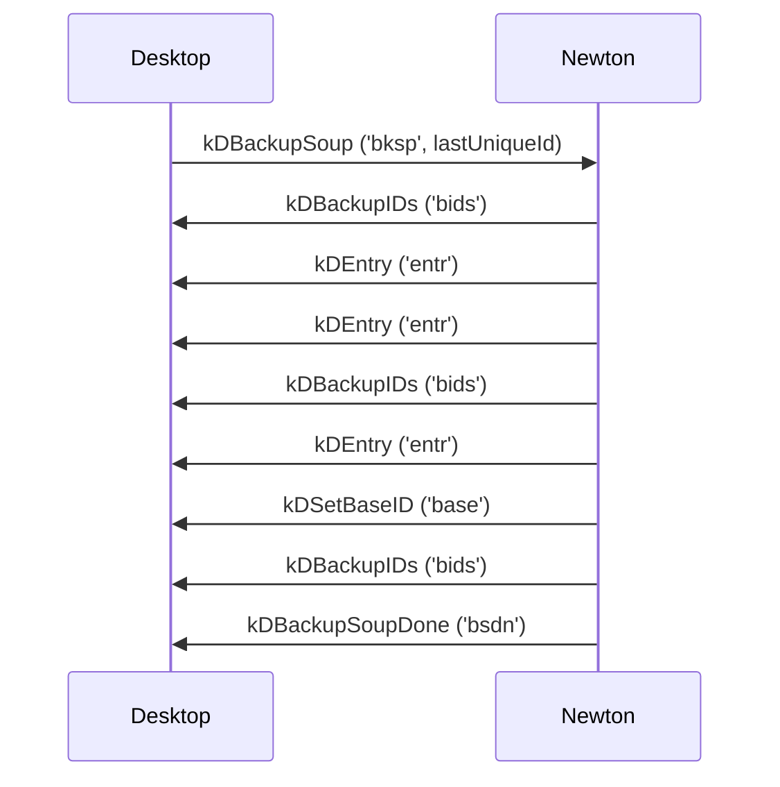

##### `kDSetStoreName` — 4 longs + ref

```text
'ssna'
length
name ref
```

Renames the current store.

##### `kDCallGlobalFunction` — 4 longs + symbol + args

```text
'cgfn'
length
function name symbol
args array
```

Calls a global NewtonScript function and returns its result via `kDCallResult`.

##### `kDCallRootMethod` — 4 longs + symbol + args

```text
'crmd'
length
method name symbol
args array
```

Calls a method on the root view and returns its result via `kDCallResult`.

##### `kDOperationDone` — 4 longs

```text
'opdn'
length // = 0
```

Disambiguates completion of an operation (e.g., end of a restore, or end of a sync when there are no `kDSyncResults` conflicts to report).

##### `kDOperationCanceled` — 4 longs

```text
'opcn'
length // = 0
```

Sent when the user cancels an operation; the receiver typically returns to the ready state.

##### `kDOpCanceledAck` — 4 longs

```text
'ocaa'
length // = 0
```

Sent in response to `kDOperationCanceled`.

##### `kDRefTest` — 4 longs + optional ref

```text
'rtst'
length
object // optional; if length == 0, echoed with no ref
```

Desktop-to-Newton echo test for any serialized NewtonScript object.

##### `kDUnknownCommand` — 4 longs + ref

```text
'unkn'
length
bad command // 4-char tag (data omitted)
```

Sent when an unrecognized command is received. Upon receipt, the desktop can install a protocol extension and retry or return an error; built-in Newton code always signals an error.

---

## 4. Compatibility & Testing Requirements

- **Compatibility:** Although the 2.0 protocol is a superset of 1.0, the protocol version was incremented and data structures elsewhere in Newton 2.0 changed substantially, so older versions of Newton Connection cannot interoperate with 2.0 devices.
- **Testing Requirements:** Left blank in the original ERS.

---

## 5. Appendix: NTK (Newton Toolkit) Commands

The end of the original ERS lists 4-character opcodes for the NTK Inspector/debugging protocol (note: `DCL/Link/Inspector_Commands/TDCLInspectorCommand.h` also defines `'lscb'` for `kDCodeBlock`):

| FourCC | Description |
|---|---|
| `"cnnt"` | Requests an NTK connection from the desktop |
| `"okln"` | Sent by NTK to ACK connection; if missing, Newton responds with error `-28016` |
| `"term"` | Requests disconnect (uncertain in original ERS) |
| `"stou"` | Set timeout |
| `"pkg "` | LoadPackage |
| `"pkgX"` | DeletePackage |
| `"dpkg"` | Request for Package Download (uncertain in original ERS) |
| `"code"` | `HandleCodeBlock`: takes an NSOF function frame and interprets it |
| `"fobj"` | Sends any arbitrary Newton object as NSOF to NTK |
| `"rslt"` | Returns a result back to NTK |
| `"text"` | Sends a text header to NTK |
| `"eext"` | Enter Breakloop |
| `"bext"` | Exit Breakloop |
| `"eref"` | Sends Exception Data `(char *msg, RefArg data)` |
| `"estr"` | Sends Exception Data `(char *msg, char *data)` |
| `"eerr"` | Sends Exception Data `(char *msg, long ErrNo)` |
| `"fstk"` | Sends a stackframe to NTK |
